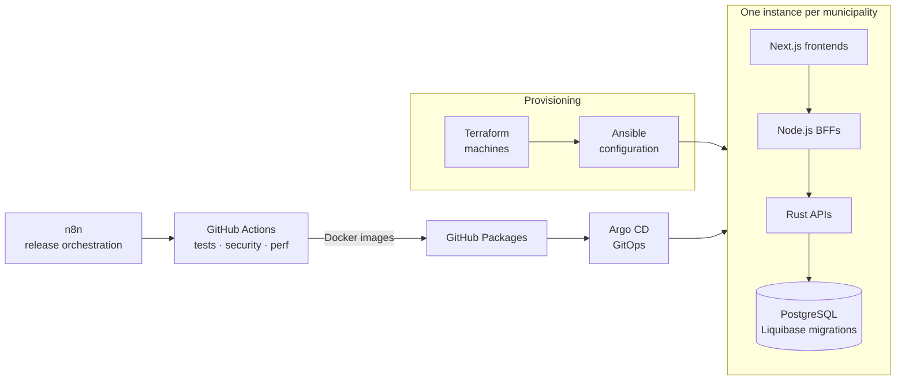

<!-- ============================================================ -->
<!--  Profile README — goes in the Quentintnrl/Quentintnrl repo   -->
<!-- ============================================================ -->

<div align="center">


<a href="https://github.com/Quentintnrl">
  
</a>

<br/>

<a href="https://linkedin.com/in/quentin-tennerel-0367621b7"></a>
<a href="https://mairie360.fr"></a>
<a href="https://github.com/mairie360"></a>


</div>

---

## 👋 About me

Final-year student at **Epitech** (Master's-level "Grande École" program, graduating June 2027) and **co-founder of [Mairie360](https://mairie360.fr)**, a SaaS platform that helps small French municipalities modernize how they work.

I'm into **backend** and **DevOps**: designing solid APIs, splitting platforms into services, and **automating everything that can be automated**, from commit to production.

```rust
struct Quentin {
    role:      &'static str,
    based_in:  &'static str,
    focus:     [&'static str; 3],
    building:  &'static str,
    learning:  [&'static str; 2],
}

const ME: Quentin = Quentin {
    role:     "Backend / DevOps · co-founder @ Mairie360",
    based_in: "Nantes area, France 🇫🇷",
    focus:    ["Rust APIs", "Microservices on Kubernetes", "CI/CD, GitOps & IaC"],
    building: "An orchestrator for AI coding agents",
    learning: ["MCP & AI agents", "中文 (Mandarin)"],
};
```

<!-- ✏️ Adjust this line to your current search -->
> 🔎 **Open to opportunities** in backend / DevOps (internship or fixed-term contract), in Paris, Nantes or remote. [Reach out on LinkedIn](https://linkedin.com/in/quentin-tennerel-0367621b7)!

---

## 🤖 Currently building: an AI agent orchestrator

A **control plane for AI coding agents**, in the spirit of Kubernetes: it doesn't do the work itself, it manages the flow between agents that take a project **from spec to production**.

- 🧩 **One agent per role** (specs, dev, PR, CI, merge, prod monitoring), so no single agent tunnel-visions on its own feature
- 🔌 **Bring your own agents and tools**: prebuilt agents or your own, with your ticketing, CI and observability stack (Jira, Linear…). Nothing is imposed
- 🚦 **Coordination built in**: when several agents hit the same unexpected issue, it's raised once in a shared registry and becomes a single ticket, and blocked work resumes automatically with updated context once it's fixed
- 👀 **Humans only when needed**: runs day and night, calls a human only when the AI decides one is required, and works the same way whether you're coding by hand with Claude Code or letting the agents run
- 📈 **Telemetry, not opinions**: tracks where and why agents get stuck (real work vs. waiting on the model vs. waiting on a human), with end-to-end traceability. You keep your own choices of tools and models

> 🛠️ Currently in the design phase.

---

## 🏛️ Flagship project: Mairie360

<table>
<tr>
<td width="60%" valign="top">

**Mairie360** gives municipal staff, elected officials and department heads a single workspace: **dashboard, projects, calendar, messaging, approval workflows and e-learning**. Everything runs in the browser.

- 🧪 **MVP in pilot** with two partner municipalities on Réunion Island
- 🔐 **Sovereign by design**: a dedicated instance per municipality instead of a shared multi-tenant database
- 👥 Team of 4 developers, spread across mainland France and Réunion
- 🌐 Open source: [github.com/mairie360](https://github.com/mairie360)

**My role:** fullstack, with a strong focus on **Rust backend and DevOps**. I designed the delivery pipeline, the CI/CD and the infrastructure.

</td>
<td width="40%" valign="top">

**At a glance**

| | |
|---|---|
| 📦 Repositories | 38 |
| 🦀 APIs | Rust |
| 🧩 BFFs | Node.js / TS |
| 🖥️ Frontends | Next.js (SSR) |
| ☸️ Runtime | Kubernetes + Argo CD |
| 🏗️ IaC | Terraform + Ansible |
| 🌍 Environments | dev · staging · prod |

</td>
</tr>
</table>

<details>
<summary><b>🔧 Architecture and delivery pipeline</b></summary>

<br/>



**What I built:**

- **Infrastructure as Code**: machines provisioned with **Terraform** and configured with **Ansible**
- **GitOps with Argo CD**: one Argo CD per environment group, each municipality on its own machines
- **Controlled promotion**: `dev-sha` → `staging-sha` → `vX.Y.Z`, with manual gates at the critical steps
- **Global versioning**: each release pins a tested combination of every service, so a municipality never has to manage compatibility between services
- **CI-driven quality**: unit, integration and e2e tests, [Newman](https://github.com/postmanlabs/newman), [k6](https://k6.io) (load), [OWASP ZAP](https://www.zaproxy.org) (DAST), [Semgrep](https://semgrep.dev), `cargo audit`, `npm audit`, accessibility checks
- **Dependencies kept up to date** by [Renovate](https://github.com/renovatebot/renovate)
- **Release pipeline orchestrated by n8n**, step by step (DB → APIs → BFFs → frontends), and restartable from any step
- **MCP servers** (in progress) to expose the platform to AI agents running in n8n workflows

</details>

---

## 🛠️ Tech stack

<div align="center">

**Languages**<br/>


**Backend & Frontend**<br/>


**DevOps & Cloud**<br/>


**Tools**<br/>


</div>

---

## 🚀 Other projects

| Project | Description | Stack |
|---|---|---|
| 🏆 **EPIck'em** | Tournament and prediction platform, Epitech team project with 3 people (2026–2027) | Web · fullstack |

---

## 📊 Activity

<div align="center">


</div>

---

<div align="center">

**🏆 GitHub achievements:** Pair Extraordinaire · Pull Shark ×3 · Quickdraw · YOLO

<br/>

*"A good tool fades into the background, so staff can focus on citizens."*


</div>
